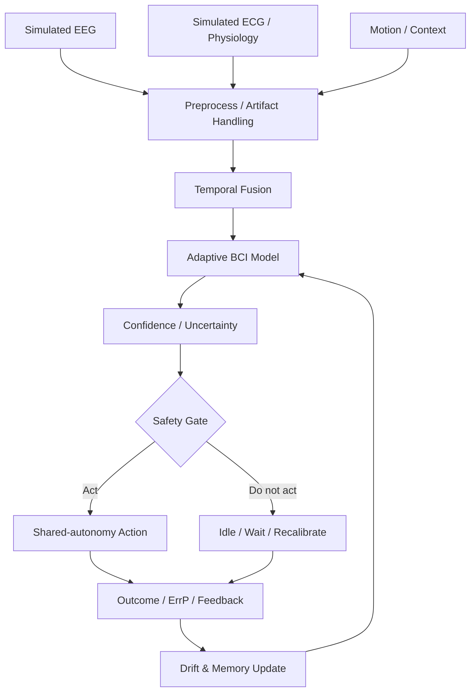

# Case Study — Wireless Brain Interface

**Domain:** Neurotechnology / Adaptive BCI / Multimodal Physiology  
**Status:** Research / Simulation  
**Project export:** Wireless Brain Interface v0.1

## Problem

Brain-computer interfaces often perform best in controlled sessions. Real-world wearables face a harder problem:

- EEG is noisy,
- electrode / device geometry changes,
- the user moves,
- physiological state changes,
- signal distributions drift,
- confidence can be poorly calibrated,
- and a false action may be more harmful than a missed action.

The project therefore focused less on maximizing a single offline accuracy score and more on **stable, uncertainty-aware behavior over time**.

## Simulation approach

We used simulated **EEG + ECG-style multimodal physiological streams** to explore how the system behaved under noise, drift, temporal misalignment, cognitive-state changes and wearable instability.

## Iterative research themes

The project went through repeated passes on:
- artifact-aware filtering,
- SNR improvement,
- drift detection,
- confidence calibration,
- false-positive and false-action reduction,
- Error-related Potential correction,
- geometry-aware adaptation,
- calibration-light latent alignment,
- multimodal temporal fusion,
- workload-aware adaptation,
- emotion-aware adaptation,
- motion-aware neuroadaptation,
- replay stabilization,
- shared autonomy,
- wearable synchronization,
- long-term personalization,
- power efficiency,
- edge deployment of EEG models.

## Key design shift

The most important conceptual shift was:

**classification confidence is not the same as permission to act.**

The architecture therefore separates:
1. decoding,
2. uncertainty estimation,
3. safety gating,
4. action.

## Maturity

This was a research/simulation project, not a clinical device. Its value is in the iterative systems reasoning around robust neuroadaptive interfaces, not a claim of medical validation.

## Evidence update — 2026-10-29

The frozen [synthetic evaluator](../benchmarks/wireless-brain-interface/SYNTHETIC_EVALUATOR.md) was independently reproduced on Ubuntu and Windows ([execution record](../benchmarks/wireless-brain-interface/EXECUTION_RECORD.md)); its synthetic drift-aware authorization gate **did not establish lower incorrect-action risk than simple confidence abstention at matched coverage**. This synthetic result is preserved, not replaced by real EEG results.

A separate **exploratory real public EEG decoding baseline** now exists on the unmerged [research branch](https://github.com/Vermicare/Haridas-Satheesh/tree/research/wbi-independent-repro-20261026):

- [A01T same-day, training-session-only held-out pilot](https://github.com/Vermicare/Haridas-Satheesh/blob/research/wbi-independent-repro-20261026/benchmarks/wireless-brain-interface/WBI_A01T_TRAINING_ONLY_PILOT_V09_RESULT.md): **43/96 correct (44.79%)** with a frozen four-class decoder; source-flag audit found **5/96 held-out trials flagged**. A [post-hoc unflagged subset](https://github.com/Vermicare/Haridas-Satheesh/blob/research/wbi-independent-repro-20261026/benchmarks/wireless-brain-interface/WBI_A01T_CLEAN_SUBSET_V11_RESULT.md) scored **42/91 (46.15%)**; this is not an independent validation or evidence of lower action risk.
- [A01E different-day confidence-only baseline](https://github.com/Vermicare/Haridas-Satheesh/blob/research/wbi-independent-repro-20261026/benchmarks/wireless-brain-interface/WBI_A01E_DIFFERENT_DAY_BASELINE_V12.md): **165/288 correct (57.29%)**, **7/288 source-flagged trials retained**, on **one subject only**. At the preselected 50% calibration target, **136 acted / 47 incorrect (34.56% incorrect-action risk)**. [Hosted reproduction](https://github.com/Vermicare/Haridas-Satheesh/actions/runs/40844636524) passed 21/21 fictional regression tests per operating system and repeated the discrete real-EEG counts. Float outputs were not byte-identical; the final evidence ZIP's contents were not independently inspected.

These different-day and same-day accuracies use **different evaluation sets**; their numerical difference does not demonstrate an improvement. Neither real-EEG experiment evaluates the proposed drift-aware gate, multiple subjects, rest-state false actions, a physical interface, clinical safety, or real-world utility. **Maturity remains Research / Simulation.**

## Next evidence gate / reframe rule

Pre-register A02–A09 different-day testing, independently seal predictions **before** held-out label scoring, retain artifact-flag sensitivity, and compare drift-aware gating against simple confidence abstention at **matched actual action coverage**. Report per-subject calibration, uncertainty, false actions and coverage; latency, power, longitudinal robustness and clinical performance remain **TBD**. Reframe the drift-gate claim if it does not outperform the simpler confidence-only comparator at matched coverage. Do not advance maturity without independent validation.
